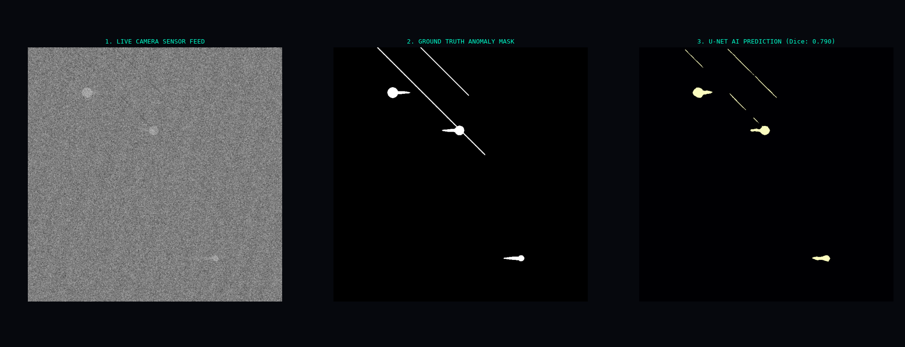
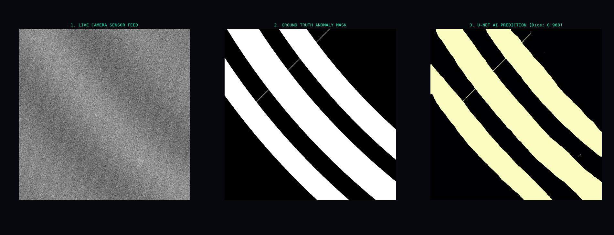
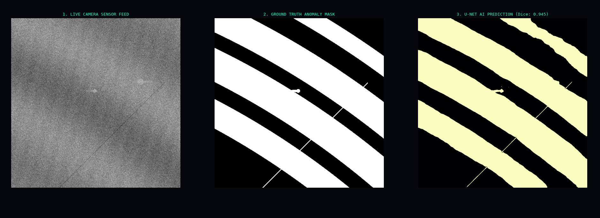
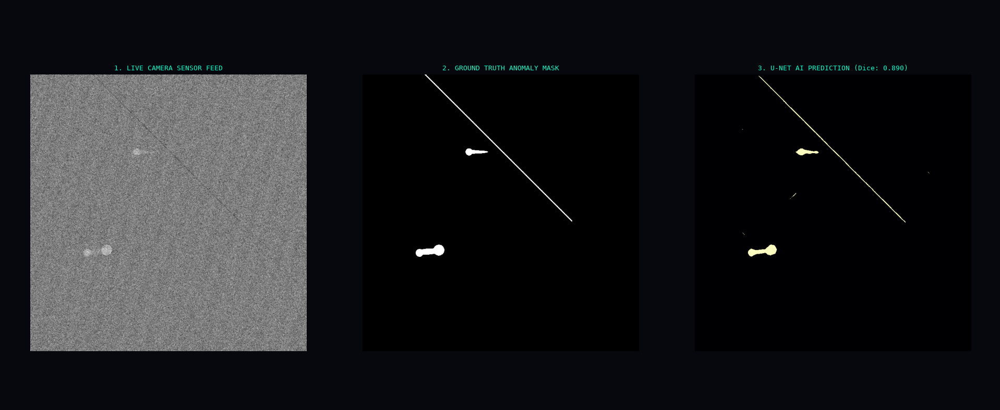

# SWIR Silicon Wafer Defect Metrology AI

[](https://www.python.org/)
[](https://pytorch.org/)
[]()

**Physics-Informed Short-Wave Infrared (SWIR) Optical Reflectance Modeling and Deep Semantic Segmentation for Subsurface Silicon Wafer Inspection.**

---

## Abstract

Subsurface carrier-concentration anomalies in doped silicon wafers—such as crystal slip lines, implanter scan striations, thermal anneal arcs, and particle shadow voids—are largely transparent or low-contrast under conventional visible-light optical inspection. However, because free-carrier absorption and plasma resonance scale strongly with wavelength in the Short-Wave Infrared (SWIR) regime, these defects produce measurable perturbations in complex refractive index and surface reflectance.

This repository presents an end-to-end physics-to-AI pipeline that:
1. Models wavelength-dependent free-carrier optical reflectance in doped silicon from first principles using the **Drude dielectric function**.
2. Synthesizes high-resolution ($1000 \times 1000$), sensor-realistic InGaAs SWIR imagery paired with pixel-accurate ground-truth defect masks.
3. Trains a 4-stage residual-style **`DefectUNet`** architecture using mixed precision and compound `BCE + Dice` loss to segment low-SNR subsurface anomalies directly from noisy SWIR camera feeds.

---

## Table of Contents

- [Physical Forward Model](#physical-forward-model)
- [Defect Taxonomy](#defect-taxonomy)
- [System Architecture & Pipeline](#system-architecture--pipeline)
- [Experimental Results & Qualitative Evaluation](#experimental-results--qualitative-evaluation)
- [Repository Structure](#repository-structure)
- [Installation](#installation)
- [Usage & Reproduction](#usage--reproduction)

---

## Physical Forward Model

The optical response of spatially varying active carrier concentration $N(x, y)$ across a doped silicon substrate is governed by the classical **Drude free-carrier dispersion model**. At angular optical frequency $\omega = \frac{2\pi c}{\lambda}$, the complex relative permittivity $\varepsilon(\omega)$ is given by:

$$\varepsilon(\omega) = \varepsilon_{\infty} - \frac{\omega_p^2}{\omega^2 + i\gamma\omega}$$

where $\varepsilon_{\infty}$ is the high-frequency lattice dielectric constant of silicon, $\gamma = \frac{e}{m^* \mu}$ is the carrier damping (scattering) rate, and $\omega_p$ is the **screened plasma frequency**:

$$\omega_p^2 = \frac{N e^2}{\varepsilon_0 \varepsilon_{\infty} m^*}$$

From $\varepsilon(\omega) = \varepsilon_1 + i\varepsilon_2$, the per-pixel complex refractive index $\tilde{n} = n + ik$ and normal-incidence Fresnel reflectance $R(\lambda)$ are computed analytically:

$$n = \sqrt{\frac{\vert{}\varepsilon\vert{} + \varepsilon_1}{2}}, \qquad k = \sqrt{\frac{\vert{}\varepsilon\vert{} - \varepsilon_1}{2}}, \qquad R = \frac{(n - 1)^2 + k^2}{(n + 1)^2 + k^2}$$

To replicate real-world **InGaAs focal-plane array (FPA)** inspection conditions, the forward simulator applies:
- Wavelength-dependent spectral illumination sweeps ($\lambda \in [450\text{ nm}, 2450\text{ nm}]$).
- Signal-dependent **shot noise** and sensor readout noise floor.
- Dynamic percentile contrast normalization matching automated optical inspection (AOI) gain control.

---

## Defect Taxonomy

The synthetic generator models four primary semiconductor fabrication anomalies as spatial perturbations in active dopant density $N(x, y)$:

| Defect Class | Physical Origin | Morphological & Optical Signature |
| :--- | :--- | :--- |
| **Crystal Slip Lines** | Thermal stress gradients during rapid thermal processing (RTP) | High-aspect-ratio crystallographic linear dislocations with sharp carrier trapping |
| **Implanter Scan Striations** | Beam current fluctuations or mechanical scan overlap errors | Periodic diagonal/banded carrier-concentration oscillations across the wafer |
| **Thermal Anneal Arcs** | Non-uniform radial heating across the susceptor | Low-frequency curved intensity gradients masking subtle local features |
| **Particle Shadow Voids** | Micro-contamination masking ion implantation | Localized circular depletion cores accompanied by directional beam-shadow tails |

---

## System Architecture & Pipeline

```text
┌──────────────────────────┐     ┌──────────────────────────┐     ┌──────────────────────────┐
│  1. Physics Forward Sim  │     │  2. Synthetic Dataset    │     │  3. DefectUNet Training  │
│  • Drude Dielectric Fn   │────▶│  • 1000x1000 SWIR Feeds  │────▶│  • 4-Stage Encoder-Decoder │
│  • InGaAs Shot Noise     │     │  • Binary Defect Masks   │     │  • Mixed Precision (AMP)   │
│  • Contrast Norm         │     │  • Multithreaded Export  │     │  • Compound BCE + Dice     │
└──────────────────────────┘     └──────────────────────────┘     └──────────────────────────┘
```

- **Network Architecture (`DefectUNet`)**: A 4-stage symmetric encoder-decoder U-Net featuring skip connections to preserve high-frequency spatial localization (essential for 1–3 pixel wide crystal slip lines) alongside multi-scale contextual aggregation (essential for broad implanter striations).
- **Loss Formulation**: Trained with an equally weighted combination of Binary Cross-Entropy and soft Dice loss ($\mathcal{L} = \mathcal{L}_{\text{BCE}} + \mathcal{L}_{\text{Dice}}$) to mitigate extreme foreground-background class imbalance on sparse wafer defects.

---

## Experimental Results & Qualitative Evaluation

Evaluated on unseen, on-the-fly generated SWIR sensor frames (`tester.py`), `DefectUNet` achieves **Dice similarity coefficients ranging from $0.79$ to $0.97$** across single- and multi-defect regimes, successfully extracting sub-visual slip lines and low-contrast particle tails buried in sensor shot noise.

| Test Case & Regime | Live Camera Sensor Feed (Input) \| Ground Truth Mask \| U-Net Prediction | Dice Score |
| :--- | :---: | :---: |
| **Case A: Multi-Class Co-occurrence**<br>*Broad implanter striations intersecting fine crystal slip lines and a central particle void.* |  | **$0.945$** |
| **Case B: Background Gradient & Dense Banding**<br>*High-amplitude diagonal scan striations with orthogonal micro-slip lines.* |  | **$0.968$** |
| **Case C: Sparse Point & Line Defects**<br>*Low-SNR particle shadow voids co-occurring with an elongated slip dislocation.* |  | **$0.898$** |
| **Case D: Extreme Low-Contrast Multi-Void**<br>*Multiple faint particle wakes overlapping parallel twin slip lines near the noise floor.* |  | **$0.790$** |

---

## Installation

1. **Clone the repository**
   ```bash
   git clone [https://github.com/](https://github.com/)<your-username>/<your-repo-name>.git
   cd <your-repo-name>
   ```

2. **Create and activate a virtual environment**
   ```bash
   python -m venv .venv
   # Windows:
   .venv\Scripts\activate
   # Linux/macOS:
   source .venv/bin/activate
   ```

3. **Install dependencies**
   Install PyTorch matching your local CUDA toolkit from [pytorch.org](https://pytorch.org/), then install the remaining packages:
   ```bash
   pip install -r requirements.txt
   ```

---

## Usage & Reproduction

### 1. Interactive Spectral Physics Explorer
Sweep illumination wavelengths across the Visible-to-SWIR transition ($450\text{ nm} \rightarrow 2450\text{ nm}$) to inspect carrier-induced reflectance contrast:
```bash
python sample_sim.py
```
- `←` / `→` (or `↑` / `↓`): Adjust illumination wavelength ($\lambda$).
- `G`: Toggle between `magma` pseudocolor and raw InGaAs grayscale.

### 2. Synthetic Dataset Generation
Generate paired $1000 \times 1000$ SWIR reflectance frames and ground-truth segmentation masks under `dataset/images/` and `dataset/masks/`:
```bash
python generator.py
```

### 3. Model Training
Preload the generated dataset into system RAM and train `DefectUNet` for 70 epochs using mixed precision (`bfloat16`/`float16`), saving the highest validation Dice checkpoint to `defect_unet.pth`:
```bash
python train.py
```

### 4. Live Inference & Evaluation
Launch the real-time inference visualizer to benchmark `defect_unet.pth` against newly synthesized sensor feeds:
```bash
python tester.py
```
- `SPACE` or `R`: Synthesize a new wafer sample and compute live inference & Dice score.
